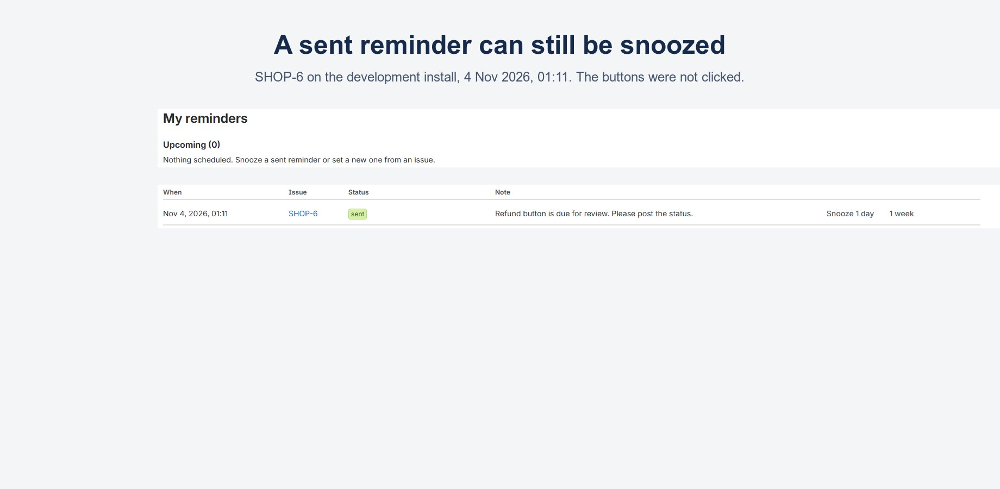
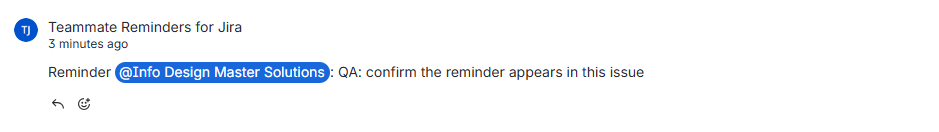

# Teammate Reminders for Jira: user guide

Teammate Reminders is a Jira Cloud app by Design Master Solutions. Set a reminder on any issue for yourself, the assignee, the reporter, the watchers or specific teammates, at an exact date and 24-hour time. This repository holds the public documentation and is the place to report problems.

Install [Teammate Reminders for Jira from the Atlassian Marketplace](https://marketplace.atlassian.com/apps/2781565032/teammate-reminders-for-jira). Ask a Jira admin to install it on your Jira Cloud site and activate its subscription.

## Set a reminder

1. Open a Jira issue. Below the title, click the **View app actions** icon and choose **Reminders**. The panel stays on the issue.
2. Pick the **Date** and the **Time (24h)**. The list offers 15-minute steps and you can type any minute. Enter times in your browser’s local time zone; changing your Jira profile does not change the browser clock. The shortcuts above the fields fill both in one click: **In 1 hour** and **In 3 hours** (rounded up to the next quarter hour), **Today 17:00** (offered until 16:00), **Tomorrow 09:00** and **Next Monday 09:00**.
3. Under **Remind**, choose Me, Assignee, Reporter or Watchers. Add up to 20 people in **Also remind these people**.
4. Under **How**, choose one:
   - **Private e-mail from Jira**: only the recipients see it. The subject carries the issue key and your note (`Reminder: KEY: note (summary)`), so it reads in the inbox list.
   - **Comment with @mention**: a comment visible to people who can read the issue, mentioning the selected people. Jira controls notification delivery; a posted comment does not prove a bell notification or email arrived. Watchers alone do not resolve to mentions: choose Me, Assignee, Reporter or specific people, or use private email for Watchers.
5. Under **Repeat**, choose Once, Every day, Every weekday (Mon-Fri), Every week or Every month. Every weekday skips Saturday and Sunday in your own time zone, so a Friday reminder comes back on Monday at the same local time. Every month keeps the same day of the month and the same local time; a shorter month uses its last day.
6. Add an optional **Note** and click **Set reminder**.

Recipients are resolved when the reminder is sent, so if the issue changes hands the new assignee gets it. With **Skip if the issue is already done** on, a reminder on a finished issue is not sent, and a repeating reminder stops.

The app checks for due reminders every 5 minutes. Delivery is not an exact-time guarantee: processing and retries can delay it. Check **Apps > My reminders** for the current status.

## See, snooze and cancel your reminders

- **On the issue:** the panel lists what is upcoming there, with a **Cancel** button.
- **Everywhere:** in the Jira sidebar, open **Apps > My reminders** for the reminders you created: **Upcoming** on top, the next one to go out first, and **History** below (sent, cancelled, failed), newest first. **Snooze 1 day** or **1 week** moves an upcoming reminder later, or sends a reminder that already went out once more, one day or one week from now; **Cancel** stops an upcoming one. The status says why a reminder did not go out: **not sent: issue was done** (you chose to skip done issues), **not sent: issue deleted**, **not sent: nobody to notify** (for example, no assignee yet), **retrying (N of 5)** while Jira is not answering, and **failed after 5 tries** after that.

### What snooze changes

Only the creator can snooze or cancel a reminder. Snooze buttons appear for pending reminders and sent one-off reminders. A future reminder moves 1 or 7 days beyond its existing due time; an overdue or sent reminder moves 1 or 7 days from now. Cancelled reminders must be created again from the issue.

Snoozing a monthly reminder also changes the day used for future repeats. For example, moving a reminder to February 28 makes its next monthly occurrence March 28. Without snoozing, a schedule originally set for the 31st uses the last day of February and returns to March 31.

### A sent one-off keeps Snooze

The Marketplace highlight "Every reminder in one list" shows this screen. On the app, **Snooze 1 day** and **1 week** stay on a reminder that already went out once. The listing caption is "My reminders on 21 Nov 2026. Sent SHOP-6 still has Snooze 1 day and 1 week." The image file on the listing is `2689ffda-3481-4c9c-bcab-751ec1302391`. Atlassian recompressed it, so the bytes differ from the file in this guide.

Measured on 21 November 2026 on the existing Forge development installation. Upcoming was empty: "Nothing scheduled. Snooze a sent reminder or set a new one from an issue." In History, `SHOP-6` was **sent**, shown as **4 Nov 2026, 01:11**, with the note "Refund button is due for review. Please post the status." That row offered **Snooze 1 day** and **1 week**. Cancelled rows on the same page did not. The buttons were not clicked, so the site stored nothing new.



What those buttons change comes from the production logic (source `5b668669`), run at `2026-11-22T01:42:54.529Z` and not applied on the site:

- **Snooze 1 day** on a sent one-off makes it pending again, due `2026-11-23T01:42:54.529Z`, retry count 0.
- **Snooze 1 week** on that same sent one-off makes it pending, due `2026-11-29T01:42:54.529Z`.
- **Snooze 1 day** on a pending reminder that is still one hour away moves that due time by 24 hours, to `2026-11-23T02:42:54.529Z`. It does not start the day from the moment you click.

[Install Teammate Reminders for Jira](https://marketplace.atlassian.com/apps/2781565032/teammate-reminders-for-jira). This screen is the development installation, not a new Marketplace install and not a clicked snooze.

### If a reminder does not arrive

| What you see | What to do |
|---|---|
| **retrying (N of 5)** | The app will try again. Check the status after a later scheduled run before creating a duplicate. |
| **failed after 5 tries** | Automatic retries have stopped. Check that the issue is accessible and contact support with the issue key, due time and status. Once the cause is resolved, set a new reminder from the issue. |
| **not sent: nobody to notify** | Check that the selected role has a person, such as an assignee, or choose a specific teammate. Create a new one-off reminder if needed. |
| **not sent: issue was done** | The skip-done option prevented delivery and stopped any recurrence. Create a new reminder and turn that option off if a completed issue still needs follow-up. |
| **not sent: issue deleted** | Set a reminder on the replacement issue, if one exists. |
| Subscription not active | Ask a Jira admin to activate or renew the app subscription. |
| Reminders turned off for this project | Ask a Jira admin to check the project allowlist. |

New reminders must be at least 1 minute in the future and within the next 12 months. Notes can have up to 1,000 characters; at least one recipient role or person must be selected.

## Worked example: follow up on a supplier every weekday

Use this when an open issue needs a weekday follow-up from whoever owns it at the time. This example reminds a person; it does not create recurring issues.

[Install Teammate Reminders for Jira](https://marketplace.atlassian.com/apps/2781565032/teammate-reminders-for-jira), or ask your Jira admin to install it, then try the example on a test issue assigned to you. Review the current Marketplace pricing and subscription terms with your admin before activating it.

**Example input:** an open issue `OPS-42`, titled `Confirm replacement shipment`, with an assignee. The key and people here are illustrative, not a customer record.

1. Open **View app actions > Reminders** on your test issue.
2. Choose a future weekday at **09:00** in your local time. For the fixed example below, use Friday **20 November 2026**, in UTC-3; if that date has passed, pick a future weekday instead.
3. Under **Remind**, select **Assignee** only. Leave **Also remind these people** empty. Choose **Private e-mail from Jira**, then **Every weekday (Mon-Fri)**.
4. Enter `Check supplier confirmation` as the note, keep **Skip if the issue is already done** enabled, and click **Set reminder** once.
5. Open **Apps > My reminders** and find the pending reminder under **Upcoming**. Check the issue key and scheduled time before leaving it running.

**Expected first result:** when the scheduled job processes the due reminder, the app asks Jira to notify the current assignee. If ownership changed after you set it, the new assignee is selected. For the sample issue, the generated subject is:

```text
Reminder: OPS-42: Check supplier confirmation (Confirm replacement shipment)
```

For a successful run on Friday 20 November at 09:00 UTC-3, the next due time is Monday 23 November at 09:00 UTC-3 (12:00 UTC). The repeating reminder stays under **Upcoming** with its next due time; do not expect a separate **History** row for each successful occurrence. The scheduler checks every five minutes, so 09:00 is a due time, not a guaranteed inbox arrival time. A successful Jira request does not prove that an email reached the inbox.

**Finish the test:** click **Cancel** on the upcoming reminder. In a real follow-up, moving the issue to a status in Jira’s Done category before the next run makes the skip-done option stop the recurrence. If it does not arrive, use the recovery table above before creating another reminder.

**Validation scope:** the sample recipient, exact subject, Friday-to-Monday calculation and Done-category detection were checked against the app’s production logic. This is a worked example, not evidence of an email delivered to a real user. Time-zone example assumes a fixed UTC-3 offset.

## Worked example: leave a visible reminder on a test issue

Choose this when the follow-up should remain in the issue's conversation, rather than only in someone's inbox. The note is visible to people who can read that issue; use private email when it should only go to the chosen recipients.

[Install Teammate Reminders for Jira](https://marketplace.atlassian.com/apps/2781565032/teammate-reminders-for-jira). The public listing's **Try it free** opens **Select a site**, followed by **Review and install**. An admin should review the current price and subscription terms before activation. If you see **Request app**, follow the admin-request path instead. An existing installation can go straight to the issue steps below.

1. Open a test issue that you can browse and comment on, in a status outside Jira's Done category.
2. Open **View app actions > Reminders**. Set a time a few minutes in the future, allowing at least one minute before saving. A due time is not a guaranteed delivery time; the app checks every five minutes.
3. Keep **Me** as the only recipient and leave **Also remind these people** empty. Choose **Comment with @mention (bell + e-mail)** and **Once**.
4. Enter `QA: confirm the reminder appears in this issue`. Keep **Skip if the issue is already done** enabled. Click **Set reminder** once and verify the saved time under **Upcoming on this issue**.
5. After processing, refresh the issue and open **Activity > Comments**. Look for a comment by Teammate Reminders that mentions your account and contains the exact note. In **Apps > My reminders**, the one-off should move to **History** with **sent**. These are separate checks: do not treat the initial success banner as proof of delivery.

Expected comment, where the account name is an actual Jira mention:

```text
Reminder @your-account: QA: confirm the reminder appears in this issue
```

**If nothing appears:** check My reminders before setting another reminder. With **Watchers** alone, comment mode has no individual recipients and ends with **not sent: nobody to notify**; choose a named person or switch to private email. An unassigned issue also needs another recipient if you selected only Assignee. A Done-category issue is skipped when skip-done is enabled. Permission errors and retries are covered in the recovery table above.

**Finish:** Once does not schedule another occurrence. To stop it before processing, use **Cancel**. Do not click **Snooze** after a successful test unless you want another reminder. The comment is part of the issue history, not a private message.

### Verified QA result, 18 November 2026

On our existing Forge **development** installation, we scheduled the example on test issue `LEG-8` for **23:20 UTC-3**, with **Me**, **Comment with @mention** and **Once**. Jira created comment `10036` at **23:20:25 UTC-3**, authored by **Teammate Reminders for Jira**, with the exact note and a mention of our own account. My reminders changed from **Upcoming (1)** / **pending** to **Upcoming (0)** and a **sent** row in History.



This proves a scheduled comment on the QA installation, not a new Marketplace installation, production subscription activation or email delivery. The screenshot is public so you can inspect the result without access to our test site. [Try the same steps with Teammate Reminders for Jira](https://marketplace.atlassian.com/apps/2781565032/teammate-reminders-for-jira).

## For Jira admins


**Jira settings > Apps > Teammate Reminders** takes a list of project keys (for example `SHOP, OPS`). Reminders can then be set only in those projects. Empty means every project.

## Data and privacy

The app is Runs on Atlassian: it has no servers of its own and sends no data outside Atlassian. It stores, in Atlassian Forge storage of your site, the issue key, the Atlassian account IDs of the creator and the people chosen, the date, the options and the note of each reminder. It reads issue data only to write the reminder. Once a week it reports the stored account IDs to Atlassian through the Personal data reporting API, and when an account is closed it erases that person's reminders and removes them from other people's. Privacy policy: https://www.designmastersolutions.com/privacy.html

## Pricing

Sold through the Atlassian Marketplace, per Jira user. See the Marketplace listing for the current price.

## Support

- Ticket: https://portal.designmastersolutions.com/submitticket.php
- E-mail: info@designmastersolutions.com

Answers in English or Portuguese.
